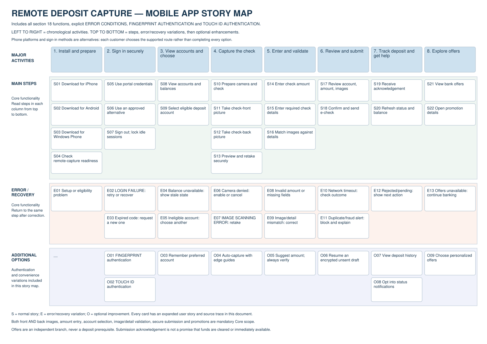
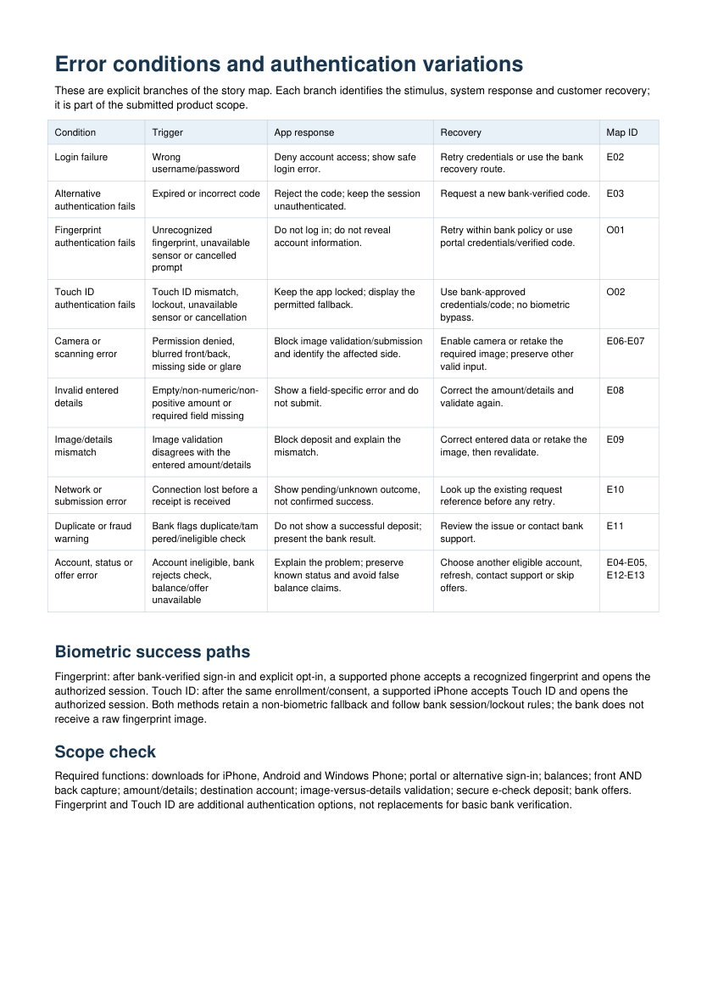

# Remote Deposit Capture — story map with explicit error conditions and biometrics

**Upload [Story_Map_WITH_ERRORS_AND_BIOMETRICS.pdf](Story_Map_WITH_ERRORS_AND_BIOMETRICS.pdf) in a new attempt, replacing the previous file.** The complete PDF has eight pages. Do not submit this README or the preview images in place of the PDF.

The first page is the actual chronological story map. The second page is titled **Error conditions and authentication variations** and contains a concrete trigger/response/recovery table, followed by explicit biometric success paths. Check both pages before uploading.

## Changes addressing the 22/30 feedback

The previous assessment awarded full overall-quality and format marks but only the basic functionality score. This document makes the missing category explicit without changing the correctly structured backbone:

- All section-18 capabilities remain present: three phone platforms, portal/alternative sign-in, balances, secure front/back images, amount/details, destination account, image/detail validation, e-check submission and offers.
- Login failure, expired code, camera permission/scanning problems, blurred/missing images, invalid details, amount/image mismatch, timeout, duplicate/fraud result and rejected/pending outcomes have explicit app responses and recovery actions.
- Fingerprint authentication and Touch ID authentication are named on the map and have success, enrollment/consent, error and fallback behavior in the supporting page.
- Core functionality and variations are not hidden only in a future release plan; additional authentication/convenience options are explicitly included in the map scope. Compatible-device and bank-policy assumptions remain identified.
- No personal name or submission date appears in document content. PDF author and creation/modification date fields are empty.

The 44 stable story IDs link the map, readable activity breakdown, coverage matrix and expanded customer stories. The PDF contains searchable map text, not a generic description of extracting a file. All story IDs, specific error/biometric content, metadata and page bounds were checked; the error table was visually inspected. Assessment remains subject to the actual file uploaded and the Coursera grader; no particular score is guaranteed.
