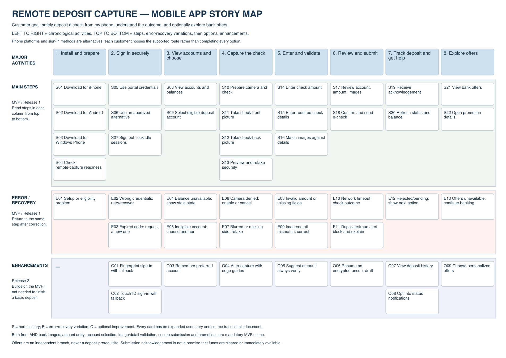

# Remote Deposit Capture — revised mobile story map

**Upload [Remote_Deposit_Story_Map_REVISED.pdf](Remote_Deposit_Story_Map_REVISED.pdf) as the new submission.** It contains the actual story map on its first page, readable text versions of the same activity/variation structure, the section-18 coverage matrix and expanded customer stories. The complete PDF has seven pages.

The first page must show the heading **REMOTE DEPOSIT CAPTURE — MOBILE APP STORY MAP**, eight activity columns, green MAIN STEPS, orange ERROR / RECOVERY, and blue ENHANCEMENTS rows. Check this before uploading to avoid submitting the wrong file. The DOCX companion has an actual editable Word table, not only an embedded screenshot. Story_Map.txt is an accessible fallback, not the recommended submission.

## Rubric coverage

- Chronological activities are at the top, with related steps and variations underneath each activity.
- 22 main stories cover all section-18 mobile functionality: iPhone/Android/Windows Phone, portal or alternative authentication, balances, secure front/back capture, entered amount/details, account selection, image/detail validation, e-check submission and bank promotions.
- 13 explicit error/recovery stories include wrong credentials, expired identity code, failed setup, unavailable balance, ineligible account, denied camera permission, blurred/missing image, invalid amount/fields, image/detail mismatch, submission timeout, duplicate/fraud alert, bank rejection/pending result and unavailable offers.
- 9 enhancements explicitly include fingerprint and Touch ID with non-biometric fallback, preferred account, assisted capture, amount suggestions, encrypted unsent draft recovery, history, opt-in status notifications and offer personalization.
- Main steps and safe recovery are part of the MVP; enhancements follow in the next release. Platform/login alternatives are choices, not steps that every user must complete. Offers never block a deposit.

All personal names and submission dates are omitted from the revised PDF, DOCX, text and preview. PDF author/creation/modification fields and Word author/date fields were removed. Original previously submitted files are retained separately for history, not linked as this revised submission.

Validation: all 44 IDs and required functionality are present in extracted PDF text; the first page contains actual map content, not a generic description. Page bounds and metadata were checked, the preview was visually reviewed, and the DOCX's native table was verified. No grade is guaranteed; the uploaded file and the peer/AI rubric assessment must be checked after submission.
