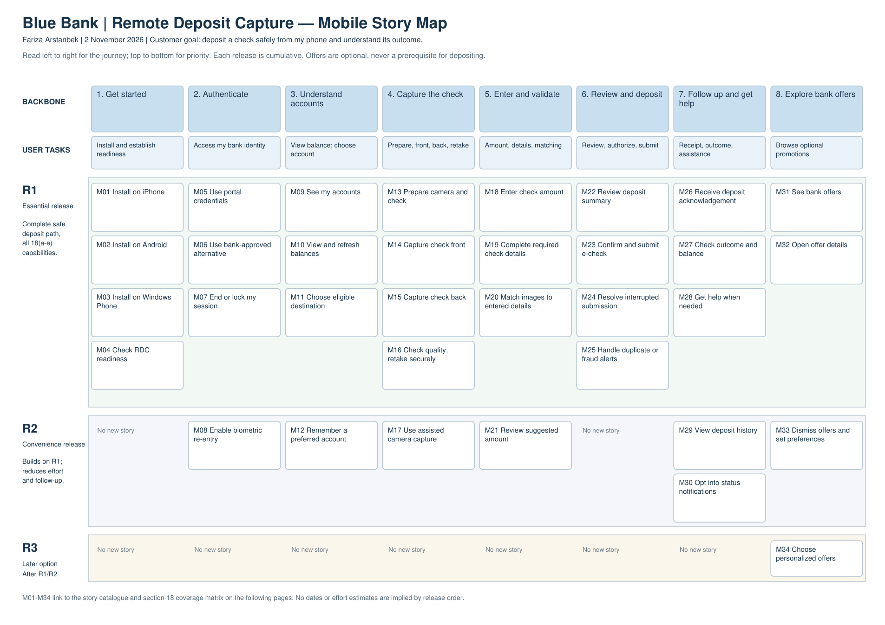

# Blue Bank Remote Deposit Capture — mobile app story map

Author: Fariza Arstanbek. Date: 2 November 2026.

**Submit [Fariza_Arstanbek_Remote_Deposit_Story_Map.pdf](Fariza_Arstanbek_Remote_Deposit_Story_Map.pdf)**. The complete PDF contains seven pages: an A3 landscape map, scope/release assumptions, a section-18 traceability matrix and acceptance checks, and the full story catalogue. The DOCX is an editable companion. Story_Map_Only.pdf is a map-only convenience export, not the full recommended submission.

Suggested project title: **Blue Bank Remote Deposit Capture — Mobile App Story Map**.

## Structure

The map reads left-to-right through eight customer activities, with user-task cards below the backbone and customer stories arranged vertically by priority. Horizontal R1/R2/R3 release slices are cumulative, not dates or effort estimates. All 34 stories have stable IDs, a customer benefit and a trace to the case or an explicit assumption.

- R1: 26 stories for the complete safe deposit path, three required phone platforms, authentication alternatives, balances, image capture/validation, account selection, secure submission/outcome and bank offers.
- R2: 7 convenience stories for supported biometric re-entry, preferred account, assisted camera, amount suggestions, history, notifications and promotion preferences.
- R3: 1 optional consent-based personalized-offers story.

The offers column is independent, not a required deposit step. R1 image-versus-entered-detail validation is mandatory even though R2 can suggest an amount before user review. Deposit receipt is not a promise of immediate clearance or available funds.

## Coverage of the supplied case, section 18

| Requirement | Stories |
|---|---|
| iPhone, Android, Windows Phone downloads | M01-M03 |
| Portal or alternative authentication | M05-M07 |
| View balances | M09-M10, M27 |
| Secure front/back check pictures | M13-M16, M25 |
| Enter amount and other check details | M18-M19 |
| Select account | M11, M22 |
| Validate images against entered details | M20, M22, M25 |
| Deposit e-check | M23-M27 |
| Bank offers/promotions | M31-M32 |

Assumptions A1-A7 distinguish inferred details from stated vision, including bank service dependencies, session protection, fraud resistance, outcome uncertainty and the fictional Windows Phone requirement. The obsolete platform is not silently omitted or replaced, nor is present-day store availability claimed.

Desktop scanners, browser plug-ins, scanner sales, portal account administration, clearing implementation and marketing content authoring remain outside the mobile-app scope. Existing support/bank services are integration dependencies, not new mobile back-office features.

The supplied case study and SampleStoryMap.docx were inspected. The example’s activity/task/story hierarchy was retained and extended with release slices and traceability. All 34 IDs, all section-18 subrequirements and PDF page bounds were checked; the map was visually inspected. This deliverable is product planning, not implemented or tested mobile software.
