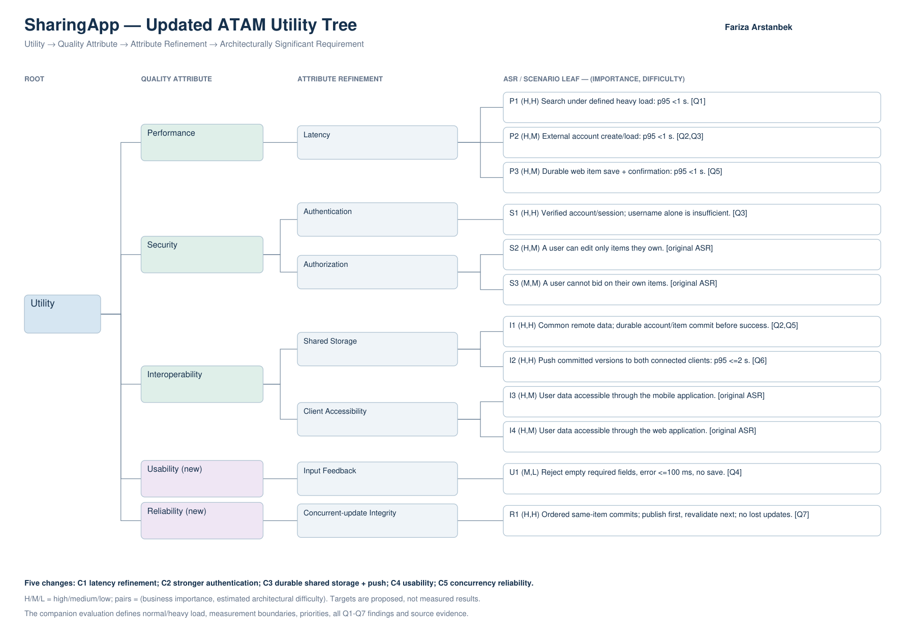

# SharingApp ATAM evaluation and updated utility tree

Author: Fariza Arstanbek. Date: 29 October 2026.

**Submit [Fariza_Arstanbek_SharingApp_ATAM.pdf](Fariza_Arstanbek_SharingApp_ATAM.pdf).** This is the single complete 7-page deliverable: six pages of explanation plus a landscape vector utility tree. The separate Updated_Utility_Tree.pdf is a convenience copy of the diagram only and does not replace the required explanations.

## Assignment coverage

All seven scenarios in the supplied Quality Attribute Scenarios.pdf are reproduced with their source, stimulus, artifact, environment, response and original response measure. Each receives a primary ATAM classification and an explanation of at most three sentences:

| Scenario | Primary finding |
|---|---|
| Q1 Search under heavy load | Sensitivity point: dataset/query/payload/load strongly influence latency |
| Q2 Account creation stored externally | Risk: only local persistence is implemented; shared durable identity needs authoritative storage |
| Q3 Account login loaded externally | Risk: username lookup is not proof of identity; authoritative account/session needed |
| Q4 Empty required item fields | Bounded non-risk: local fail-fast validation exists; timing and broader invalid inputs remain unverified |
| Q5 Web item save/confirmation | Tradeoff: truthful durable confirmation versus shorter perceived latency |
| Q6 External data changes pushed | Risk: local Observer is not cross-client propagation |
| Q7 Two users change the same data | Risk: no established shared transaction/version protocol prevents lost/conflicting updates |

Exactly five groups of changes are justified: refine latency; strengthen authentication; refine durable shared storage and propagation; add Usability/Input Feedback; add Reliability/Concurrent-update Integrity. All original utility-tree branches are retained. Importance/difficulty pairs, leaf IDs and Q1-Q7 references connect the tree to the analysis. Proposed numeric criteria include workload assumptions and tests; they are not represented as measured results or stakeholder-approved requirements.

## Basis and limitations

This analysis inspected the newly supplied older SharingApp_c3_local_storage.zip and user stories, rather than assuming they were identical to the later Android archive. Concrete methods and file/line references are recorded in the PDF evidence register. The earlier component/deployment architecture is a proposed remote system, not remote server code present in this archive.

Android SDK/emulator and a running remote backend were unavailable. The application was not built or run; static analysis is not claimed to establish timing, security or concurrency compliance. The report is a focused ATAM-style scenario analysis, not a completed stakeholder workshop. Priorities, thresholds, authentication improvements, transaction behavior and notification semantics require validation/approval.

Both source and proposed-architecture evidence are distinguished. Finding IDs SP1/RK1-RK4/NR1/TP1 are separate from tree leaf IDs P1-P3/S1-S3/I1-I4/U1/R1.

PDF validation: seven readable pages, all seven scenario IDs and five change IDs present, text within bounds. The utility tree and evaluation page were visually checked. Original application source is unchanged.
