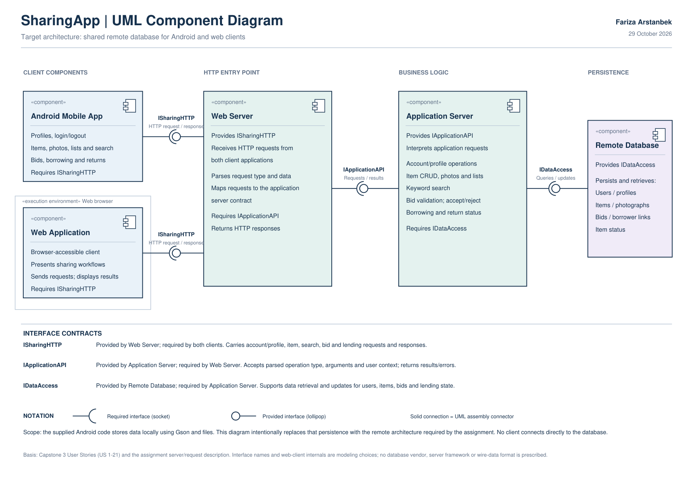

# SharingApp — UML Component Diagram

Author: Fariza Arstanbek. Date: 29 October 2026.

**Submit [Fariza_Arstanbek_SharingApp_Component_Diagram.pdf](Fariza_Arstanbek_SharingApp_Component_Diagram.pdf)** to Coursera. It is a single-page landscape A3 vector PDF. Do not submit the SVG/PNG in place of the requested PDF.

## Architecture and UML notation

The five modeled components are Android Mobile App, Web Application, Web Server, Application Server, and Remote Database. The web application is grouped inside its browser execution environment. This is a component-level model, not a class, sequence or physical deployment diagram.

- Both clients require ISharingHTTP; Web Server provides it. Requests/responses use HTTP as specified.
- Web Server requires IApplicationAPI; Application Server provides it and interprets the operation and payload.
- Application Server requires IDataAccess; Remote Database provides it for queries and updates.
- Required interfaces use sockets, provided interfaces use lollipops, and solid assembly connectors join matching interfaces. The repeated ISharingHTTP label denotes the same contract used by both clients, not separate incompatible APIs.
- No direct client-to-database connection exists. Replies/results travel over the same contracts; they do not require a separate bypass dependency.

Interface names are model labels, not claims about methods already implemented. No server framework, HTTP payload encoding or database vendor was specified by the task, so none is invented.

## User-story coverage

| Scope | Capstone 3 stories | Component responsibility |
|---|---|---|
| Item creation, details, edits, deletion | US 1-4 | Client workflows; Application Server item operations; remote item persistence |
| Owner lists by status; borrower list | US 5-9 | Application Server list/query operations; item owner/borrower/status data |
| Optional item photographs | US 10-12 | Item/photo operations and remote photograph persistence |
| Unique username, email/profile, login/logout, borrower profile | US 13-16 | Account/profile operations and remote user records |
| Browse/search non-borrowed items | US 17-18 | Application Server keyword/search filtering and database queries |
| Place/accept/reject bids and transition item status | US 19-21 | Bid validation and lending/return logic; bids and item state persisted remotely |

## Evidence and limits

The supplied Capstone3_UserStories.pdf and Android source were inspected. The archive contains activities including LoginActivity, EditUserActivity, SearchActivity, BorrowedItemsActivity and ViewItemBidsActivity; model/controller groups include User/UserList, Item/ItemList and Bid/BidList. UserList, ItemList and BidList load/save local files through Gson. The diagram intentionally models the remote-storage architecture requested by the assignment instead of reproducing those local files.

The remote web/server/database components are conceptual requirements from the assignment, not implemented components discovered in the local Android archive. Android compileSdk/targetSdk are 29 and minSdk is 19. Android SDK/emulator tools were not available in this execution environment, so application build/launch was not performed. No runtime validation is claimed. Original application code was not changed.

PDF was checked for a single readable page, required labels and content bounds; PNG was visually inspected. Editable vector source: SharingApp_Component_Diagram.svg.
