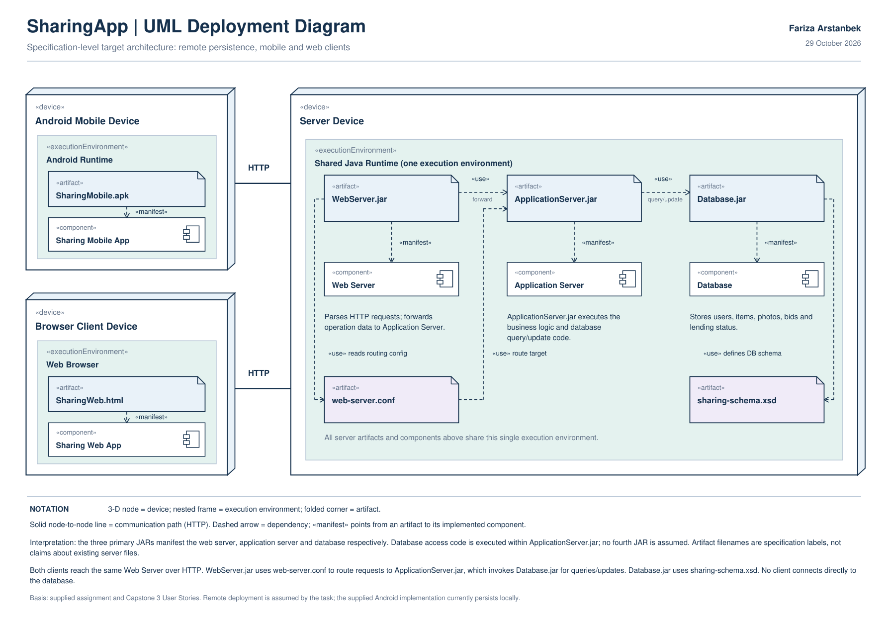

# SharingApp — specification-level UML Deployment Diagram

Author: Fariza Arstanbek. Date: 29 October 2026.

**Submit [Fariza_Arstanbek_SharingApp_Deployment_Diagram.pdf](Fariza_Arstanbek_SharingApp_Deployment_Diagram.pdf)**, a single-page vector PDF. PNG is a preview; SVG is editable vector source.

## Requirement mapping

| Assignment requirement | Diagram element |
|---|---|
| Mobile version | Android Mobile Device / Android Runtime / SharingMobile.apk / Sharing Mobile App |
| Web version accessible through a browser | Browser Client Device / Web Browser / SharingWeb.html / Sharing Web App |
| Client requests reach the remote web server over HTTP | Two HTTP communication paths from client devices to Server Device; note identifies WebServer.jar as entry point |
| Web, application and database servers reside on the same device | All three are inside Server Device |
| All three run in the same execution environment | One shared Java runtime frame encloses all three server components and their artifacts |
| Three separate JARs manifest the three components | WebServer.jar -> Web Server; ApplicationServer.jar -> Application Server; Database.jar -> Database, each labeled «manifest» |
| Web server routing configuration | WebServer.jar uses web-server.conf; config has a route-target dependency to ApplicationServer.jar |
| Application server executes a JAR for searching/modifying data | ApplicationServer.jar executes business logic and database query/update code and uses Database.jar |
| Database schema defined by XSD | Database.jar uses sharing-schema.xsd |
| HTML manifests web application | SharingWeb.html -> Sharing Web App, labeled «manifest» |
| APK manifests mobile application | SharingMobile.apk -> Sharing Mobile App, labeled «manifest» |

## Modeling choices

Node names are types, not physical machine instance IDs: this is a specification-level deployment diagram. Device nodes use 3-D node notation. Nested execution-environment frames express placement. Artifacts use the folded-corner icon, and manifestation dependencies point from artifacts to components. Solid lines between devices represent HTTP communication paths; dashed arrows express artifact dependencies. No independent runtime for each server and no direct client/database connection are introduced.

Shared Java Runtime is a chosen execution-environment type consistent with executable JARs. Artifact filenames are descriptive labels, not files claimed to be found in the supplied local-storage code. Database query/update logic is modeled as executing inside ApplicationServer.jar, satisfying the application-server JAR requirement without inventing a fourth server JAR. No vendor, IP address, deployment instance count, wire format, or database protocol was prescribed.

The source and Capstone 3 stories cover profiles/login, items/photos, owner/borrower lists, search, bids and lending state. Remote persistence is a task assumption, not the current Android implementation. The database responsibility note includes users, items, photos, bids and lending status.

## Inspection and validation

The newly supplied archive and user-stories PDF were inspected. The Android application declares com.example.sharingapp, compile/target API 29 and minimum API 19. Its local-storage implementation is intentionally replaced in the requested target model. Original application source was not modified. Android SDK/emulator is unavailable in this environment, so building/running the Android app was not performed and is not claimed.

The PDF was verified to have one page, all required labels and content within page bounds. SVG XML was parsed successfully; PNG was visually reviewed for labels, dependencies and overlap. This diagram is distinct from the previous component-diagram assignment.
